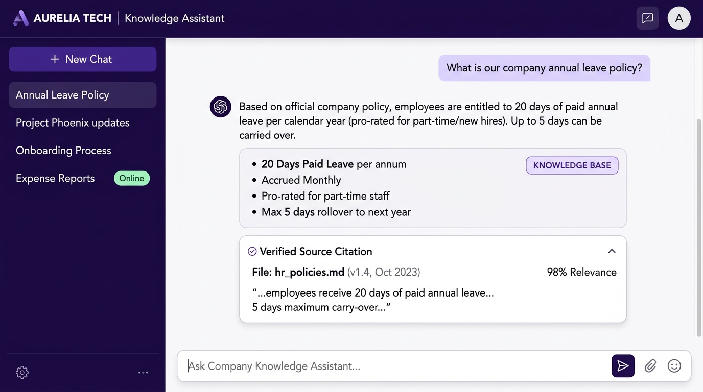

# Enterprise Company Knowledge Assistant

An agentic Retrieval-Augmented Generation (RAG) assistant designed to help employees discover grounded, verifiable information across company policies, HR benefits, IT onboarding, code of conduct, engineering standards, and active projects.

Built with **LangChain**, **LangGraph**, **Google Gemini**, **ChromaDB**, and a clean **Streamlit** chat interface styled in a modern purple-and-pearl-white enterprise palette.

<p align="center">
  
</p>

> 📘 **Detailed Technical Documentation:** For an in-depth deep dive into the system design, LangGraph state machine, dense ChromaDB retrieval, conversational memory algorithms, and security architecture, see [`docs/SYSTEM_DOCUMENTATION.md`](docs/SYSTEM_DOCUMENTATION.md).

---

## 1. System Architecture & Workflow

Rather than running naive retrieval on every query, the assistant uses an autonomous **LangGraph state machine** to route queries based on intent:

```
                          User Question
                               │
                               ▼
                      ┌─────────────────┐
                      │   Router Node   │ (Classification via Gemini)
                      └────────┬────────┘
                               │
       ┌───────────────────────┼───────────────────────┬──────────────────────┐
       │                       │                       │                      │
       ▼                       ▼                       ▼                      ▼
┌──────────────┐        ┌──────────────┐        ┌──────────────┐       ┌──────────────┐
│   RAG Node   │        │ Direct Node  │        │ Clarify Node │       │  Calculator  │
└──────┬───────┘        └──────┬───────┘        └──────┬───────┘       └──────┬───────┘
       │                       │                       │                      │
       │ (ChromaDB top-k       │ (Conversational       │ (Focused 1-question  │ (Safe AST-only
       │  + Gemini synthesis   │  greeting; memory)    │  follow-up; forces   │  arithmetic;
       │  + Citation check)    │                       │  RAG next turn)      │  DoS bounds)
       │                       │                       │                      │
       └───────────────────────┴───────────────┬───────┴──────────────────────┘
                                               │
                                               ▼
                                      Synthesized Response
                                   + Verified Source Citations
                                   + Route Audit Badge
```

### The Four Intelligent Routes

1. **`rag` (Knowledge Retrieval):** Executes dense cosine similarity search ($k=3$) against local ChromaDB storage, constructs a grounded context block, and synthesizes an answer with source citations. If context is insufficient, it produces an honest abstention.
2. **`direct` (Conversational):** Responds immediately to greetings, polite pleasantries, and small talk using sliding-window memory without wasting vector search cycles.
3. **`clarify` (Ambiguity Resolution):** Identifies vague internal questions (e.g., *"How does that policy work?"*) and asks a single targeted clarifying question. The subsequent reply is deterministically routed to the RAG path.
4. **`tool_calculator` (Deterministic Arithmetic):** Safely extracts and computes exact numerical answers (e.g., leave day balances, expense calculations) using Python's Abstract Syntax Tree (`ast`), completely rejecting unsafe functions like `eval()` and enforcing exponentiation bounds.

---

## 2. Conversational Memory & Multi-Turn Follow-Ups

The assistant features genuine conversational memory designed for realistic workplace interactions:

- **Isolated Conversation Threads:** Separate chat threads in Streamlit session state, each maintaining independent message and LangGraph turn history without cross-contamination.
- **Referential Follow-Up Resolution:** Automatically resolves pronouns and brief follow-ups (e.g., *"What about sick leave?"*, *"Can you summarize that?"*, *"How many days for that?"*) by enriching the semantic search query with preceding conversation topics.
- **Contextual Grounding:** Previous turns provide context to resolve references, but factual assertions are always anchored in newly retrieved ChromaDB document chunks rather than treating past generated output as ground truth.
- **Sliding-Window Token Control:** Bounded memory window preserves prompt efficiency and prevents unbounded token consumption.

---

## 3. Technology Stack

- **Core Runtime:** Python 3.10+ (tested on Python 3.13)
- **Agent Orchestration:** [LangGraph](https://github.com/langchain-ai/langgraph) (`StateGraph`, `START`, `END`)
- **Document Ingestion & Chunking:** [LangChain](https://github.com/langchain-ai/langchain) (`RecursiveCharacterTextSplitter`)
- **AI Models (Google Gemini API):**
  - **Embeddings:** `models/gemini-embedding-001` (3072-dimensional dense vectors)
  - **Generation & Synthesis:** `gemini-2.5-flash`
  - **Routing:** `gemini-2.5-flash` (with deterministic fallback heuristics)
- **Vector Database:** [ChromaDB](https://www.trychroma.com/) (`langchain-chroma`) with local on-disk persistence
- **Frontend / UI:** [Streamlit](https://streamlit.io/) with custom purple-and-pearl-white design tokens
- **Deterministic Math Security:** Python Standard Library `ast` & `operator`
- **Testing & Quality:** Pytest (50 unit, offline, memory, and integration tests)

---

## 4. Approved Knowledge Assets (`data/raw_docs/`)

The repository includes 11 structured demonstration documents for the fictional enterprise **Aurelia Tech**:

| Document | Primary Topics Covered |
| :--- | :--- |
| [`company_overview.md`](data/raw_docs/company_overview.md) | Mission, vision, core values, organizational structure, office hubs, and executive leadership. |
| [`hr_policies.md`](data/raw_docs/hr_policies.md) | Annual leave (20 days, 5-day rollover), sick leave, parental leave (16/6 weeks), benefits, wellness, and reviews. |
| [`it_onboarding.md`](data/raw_docs/it_onboarding.md) | Hardware specs, Slack, GitHub, VPN client (*Aurelia Connect*), MFA rules, software request thresholds. |
| [`code_of_conduct.md`](data/raw_docs/code_of_conduct.md) | Workplace professionalism, anti-harassment, data handling, conflicts of interest, and anonymous hotline. |
| [`engineering_standards.md`](data/raw_docs/engineering_standards.md) | Git branching, pull request approvals (2 reviews), coding standards, testing pyramid, and ADRs. |
| [`technology_stack.md`](data/raw_docs/technology_stack.md) | FastAPI, Python, Go, React, PostgreSQL, Redis, ChromaDB, Docker, and AWS Kubernetes (EKS). |
| [`current_projects.md`](data/raw_docs/current_projects.md) | Project Atlas (Client Success), Project Horizon (Data & AI), Project Beacon (SRE), and Innovation Time. |
| [`project_architecture.md`](data/raw_docs/project_architecture.md) | Clean Architecture layers, mTLS zero-trust, OpenAPI specifications, and event streaming. |
| [`development_workflow.md`](data/raw_docs/development_workflow.md) | Docker Compose local runtime, Alembic migrations, pre-commit hooks, CI/CD gates, and canary releases. |
| [`troubleshooting.md`](data/raw_docs/troubleshooting.md) | VPN reconnect procedures, Docker port conflicts, Alembic migration locks, and IT escalation SLAs. |
| [`glossary.md`](data/raw_docs/glossary.md) | Approved internal acronyms (PTO, MFA, HPA, SLA, ADR, PR, CSM, ARR) and department contact matrix. |

---

## 4. Setup and Installation

### Step 1: Clone and Create Virtual Environment

**Windows (PowerShell):**
```powershell
python -m venv venv
.\venv\Scripts\Activate.ps1
pip install -r requirements.txt
```

**macOS / Linux:**
```bash
python3 -m venv venv
source venv/bin/activate
pip install -r requirements.txt
```

### Step 2: Configure Environment Variables

Copy the example configuration:
```bash
cp .env.example .env
```

Open `.env` and configure your Google Gemini API key:
```ini
GEMINI_API_KEY=your_actual_gemini_api_key_here
```
*(Get a key from [Google AI Studio](https://aistudio.google.com/)).*

---

## 5. Ingestion Pipeline

### Initial Ingestion
To load, chunk, embed, and index all documents into the persistent ChromaDB store:
```bash
python -m src.ingest
```

### Safe Full Rebuild
If you update or delete documents and wish to completely rebuild the vector index:
```bash
python -m src.ingest --rebuild
```

**Ingestion Features:**
- **Deterministic Chunk IDs:** `source#chunk_{index}_{hash}` prevents duplicate indexing.
- **Incremental Indexing:** Detects unmodified files via SHA-256 and skips redundant embedding calls.
- **Batching & Rate-Limit Retries:** Automatically batches requests and handles 429 quota exceptions with exponential backoff.

---

## 6. Running the Application

### Option A: Streamlit Enterprise Web Interface (Recommended)
Launch the web interface:
```bash
streamlit run streamlit_app.py
```
Open [http://localhost:8501](http://localhost:8501) in your browser.

**Web UI Capabilities:**
- **Purple-and-Pearl-White Theme:** Clean, minimal chat design with high readability and restrained aesthetic.
- **Starter Inquiry Buttons:** Clickable starter prompts that immediately submit real questions from the knowledge base.
- **Route Badges:** Unobtrusive status badges (`Knowledge base`, `Direct answer`, `Needs clarification`, `Calculator`).
- **Expandable Verified Citations:** Inspect document title, source filename, relevance score, and verified text excerpts.
- **Live Knowledge Base Status:** Sidebar shows real-time index health, chunk counts, and active thread management.

### Option B: Interactive Terminal CLI
For lightweight terminal testing:
```bash
python app.py
```

---

## 8. Automated Testing Suite

The repository includes a comprehensive 50-test suite covering unit, offline, memory, and integration tests:

Run all tests:
```bash
pytest tests/ -v
```

### What the Test Suite Verifies:
1. **Config Validation (`test_config.py`):** Ensures defaults are valid and missing API keys are reported cleanly.
2. **Safe Calculator (`test_calculator.py`):** Verifies basic math, decimals, negatives, powers, division-by-zero protection, exponent bounds, and rejects malicious payloads (`__import__`, `eval`, `open`, variable injection).
3. **Ingestion & Chunking (`test_ingest.py`):** Tests markdown title extraction, skipping empty files, metadata preservation, and chunk ID generation.
4. **Citations & Grounding (`test_citations_and_grounding.py`):** Tests sliding-window history formatting, citation validation, and honest abstentions on out-of-scope questions.
5. **Conversational Memory & Chat (`test_memory_and_chat.py`):** Tests follow-up query enrichment, reference resolution, summarize requests, thread isolation, switching, deletion, and evidence-missing abstentions.
6. **Offline Graph Routing (`test_graph_offline.py`):** Verifies deterministic routing rules (clarification follow-up forcing RAG, greetings routing direct) and calculator execution without network dependencies.
7. **Evaluation Metrics (`test_eval.py`):** Tests precision, recall, and checkpoint save/load atomic recovery.
8. **Vector Retrieval Integration (`test_retrieve.py`):** Queries live vector store across HR, IT, and Engineering documents.
9. **StateGraph Integration (`test_graph.py`):** End-to-end integration tests confirming multi-turn execution and route dispatching.

---

## 8. Evaluation Framework (`eval/`)

The evaluation framework benchmarks the RAG pipeline against ground-truth test cases across all corporate domains.

Run evaluation:
```bash
# Run a quick smoke evaluation (2 questions)
python -m eval.run_evaluation --limit 2

# Run full benchmark evaluation
python -m eval.run_evaluation

# Reset previous checkpoint and re-evaluate all cases
python -m eval.run_evaluation --reset
```

### Metrics Tracked:
- **Context Precision:** Fraction of retrieved chunks belonging to the expected document.
- **Context Recall:** Fraction of expected source documents captured in top-$k$.
- **Faithfulness (LLM-as-a-Judge):** Uses `gemini-2.5-flash` to systematically judge whether every statement in the answer is backed by context with zero hallucinations.
- **Query Latency:** End-to-end execution time in seconds.
- **Fault-Tolerant Checkpointing:** Checkpoint results are saved to `eval/results_checkpoint.json` on each turn, allowing runs to be interrupted and resumed safely.

---

## 9. Security, Privacy & Production Considerations

- **AST Math Execution:** The calculator uses Python's Abstract Syntax Tree parser and whitelists only basic arithmetic operators, completely blocking arbitrary code execution vulnerabilities.
- **Prompt Injection Defense:** Retrieved documentation is explicitly treated as untrusted data in system prompts, ensuring embedded commands cannot hijack assistant behavior.
- **Zero Secrets Committed:** Credentials are strictly managed through `.env` and ignored via `.gitignore`.
- **Fictional Demonstration Data:** All policies, names, and contact emails in `data/raw_docs/` are fictional demonstration assets for Aurelia Tech. To deploy for your organization, replace the Markdown files in `data/raw_docs/` and execute `python -m src.ingest --rebuild`.
