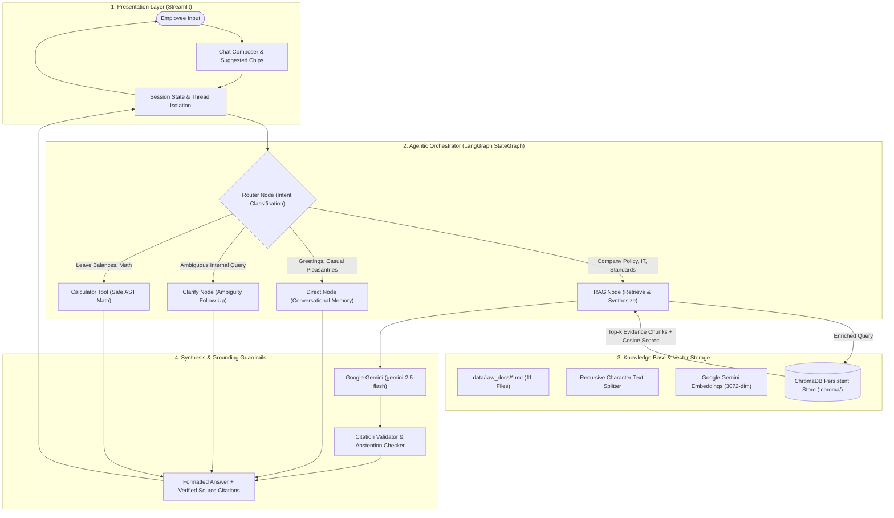

# Enterprise Company Knowledge Assistant: System Architecture & Technical Documentation

**Target Enterprise:** Aurelia Tech  
**System Type:** Autonomous Agentic Retrieval-Augmented Generation (RAG) System  
**Framework Stack:** LangChain, LangGraph, Google Gemini, ChromaDB, Streamlit, Pytest  
**Status:** Production-Ready Demonstration  

---

## Table of Contents
1. [Executive Summary & Business Objectives](#1-executive-summary--business-objectives)
2. [High-Level Architecture](#2-high-level-architecture)
3. [Agentic Orchestration Layer (LangGraph)](#3-agentic-orchestration-layer-langgraph)
4. [Document Ingestion & Dense Vector Storage](#4-document-ingestion--dense-vector-storage)
5. [Conversational Memory & Follow-Up Resolution](#5-conversational-memory--follow-up-resolution)
6. [Grounding, Source Citations & Anti-Hallucination](#6-grounding-source-citations--anti-hallucination)
7. [Security & Deterministic Tool Execution](#7-security--deterministic-tool-execution)
8. [Frontend & User Experience (Streamlit)](#8-frontend--user-experience-streamlit)
9. [Automated Testing & Evaluation Framework](#9-automated-testing--evaluation-framework)
10. [Deployment & Operations Manual](#10-deployment--operations-manual)

---

## 1. Executive Summary & Business Objectives

### 1.1 Problem Statement
Modern corporate enterprises produce vast volumes of critical documentation—HR benefits, IT onboarding guides, coding guidelines, system architecture designs, and ethical codes of conduct. Employees frequently face:
- **Information Discovery Latency:** Spending significant time locating policy specifics.
- **Naive RAG Failures:** Traditional semantic search systems search the database blindly for non-retrieval inputs (e.g., greetings, simple calculations) and fail to maintain multi-turn context when users ask follow-up questions.
- **Hallucination Risk:** Standard language models present unsupported assumptions as company facts, introducing organizational and legal liabilities.

### 1.2 The Solution
The **Enterprise Company Knowledge Assistant** solves these challenges by combining:
1. **Dynamic Intent Routing:** Classifying queries into specialized execution nodes rather than executing uniform retrieval.
2. **Contextual Semantic Retrieval:** Dense vector retrieval over persistent ChromaDB storage.
3. **Conversational Memory:** Automatic follow-up query enrichment across multiple conversation turns.
4. **Strict Grounding:** Mandatory source verification and honest abstention when documentation lacks evidence.
5. **Deterministic Arithmetic:** Dedicated AST-based calculation engine for numerical policy evaluations.

---

## 2. High-Level Architecture

The system is architected as a layered pipeline separating user presentation, agentic control, semantic search, and deterministic tool execution.



---

## 3. Agentic Orchestration Layer (LangGraph)

The core decision-making workflow is modeled as a cyclic state machine using **LangGraph** (`StateGraph`, `START`, `END`).

### 3.1 State Definition (`GraphState`)
A centralized TypedDict carries state between nodes:

```python
class GraphState(TypedDict):
    question: str                         # The active user question
    route: Optional[str]                  # "rag" | "direct" | "clarify" | "tool_calculator"
    answer: Optional[str]                 # Generated assistant answer
    sources: Optional[List[str]]          # Validated source filenames
    source_details: Optional[List[Dict]]  # Chunks, relevance scores, and excerpts
    history: List[Dict[str, Any]]         # Previous conversation turns
    is_grounded: Optional[bool]           # Grounding verification flag
```

### 3.2 The 4 Intelligent Routing Branches

```
                          User Question
                                │
                                ▼
                       ┌─────────────────┐
                       │   Router Node   │ (Regex + Gemini Classification)
                       └────────┬────────┘
                                │
        ┌───────────────────────┼───────────────────────┬──────────────────────┐
        │                       │                       │                      │
        ▼                       ▼                       ▼                      ▼
 ┌──────────────┐        ┌──────────────┐        ┌──────────────┐       ┌──────────────┐
 │   RAG Node   │        │ Direct Node  │        │ Clarify Node │       │  Calculator  │
 └──────┬───────┘        └──────┬───────┘        └──────┬───────┘       └──────┬───────┘
        │                       │                       │                      │
        │ ChromaDB Retrieval    │ Conversational        │ Single targeted      │ Safe AST-only
        │ + Gemini Synthesis    │ greeting without      │ follow-up; forces    │ arithmetic;
        │ + Citation Validation │ vector store search   │ RAG on next turn     │ DoS-bounded
        │                       │                       │                      │
        └───────────────────────┴───────────────┬───────┴──────────────────────┘
                                                │
                                                ▼
                                       Synthesized Response
                                    + Verified Source Citations
                                    + Conversational Memory
```

1. **`RAG Node`:**
   - Detects queries concerning HR policies, onboarding, hardware, code standards, or projects.
   - Enriches the query using preceding conversational turns.
   - Executes dense cosine similarity search ($k=3$).
   - Calls `gemini-2.5-flash` with strict grounding system instructions.
   - Validates that returned citations exist in the retrieved context.

2. **`Direct Node`:**
   - Responds to conversational greetings (*"Hello"*, *"Good morning"*) using sliding-window history.
   - Bypasses vector database retrieval, conserving API tokens and compute latency.

3. **`Clarify Node`:**
   - Triggered when an internal query is too vague to search effectively (*"Can I do that?"*).
   - Generates exactly one focused clarifying question.
   - The user's subsequent reply is deterministically routed to `RAG Node`.

4. **`Calculator Node`:**
   - Extracts mathematical expressions (*"20 - 7"*) and calculates exact values deterministically using Abstract Syntax Tree (`ast`) evaluation.

---

## 4. Document Ingestion & Dense Vector Storage

The knowledge pipeline ingests Markdown and text documents from `data/raw_docs/` into local **ChromaDB** storage.

### 4.1 Approved Knowledge Base Catalog (11 Documents)
| File | Topic & Scope |
| :--- | :--- |
| `company_overview.md` | Executive team, 4 core values, office hubs, and company mission. |
| `hr_policies.md` | Annual leave (20 days, 5 rollover), sick leave (10 days), parental leave (16/6 weeks), benefits, wellness stipends. |
| `it_onboarding.md` | Hardware specs, Okta SSO, MFA, VPN client (*Aurelia Connect*), software thresholds. |
| `troubleshooting.md` | VPN disconnect steps, Docker port conflicts, IT Service Desk SLAs (P1–P4). |
| `code_of_conduct.md` | Workplace conduct, anti-harassment, gift thresholds ($50), anonymous whistleblower hotline. |
| `engineering_standards.md` | Git branching, PR reviews (2 approvers required), testing pyramid (70/20/10), ADRs. |
| `development_workflow.md` | Local Docker Compose, Alembic migration locks, CI/CD gates, canary deploys. |
| `technology_stack.md` | Python, FastAPI, Go, React, PostgreSQL, Redis, ChromaDB, Kubernetes (EKS). |
| `current_projects.md` | Project Atlas (Client Success), Horizon (Data/AI), Beacon (SRE), Innovation Time. |
| `project_architecture.md` | Clean/Hexagonal architecture, mTLS, OpenAPI specifications, event streaming. |
| `glossary.md` | Corporate acronyms (PTO, MFA, HPA, SLA, ADR, PR, CSM, ARR) and department directory. |

### 4.2 Ingestion Engineering Features
- **Chunking Strategy:** `RecursiveCharacterTextSplitter` with `chunk_size=800` characters and `chunk_overlap=120` characters.
- **Deterministic Chunk IDs:** Formatted as `{source}#chunk_{index}_{sha256}`. This ensures idempotent indexing and eliminates duplicate records during re-ingestion.
- **Change Detection:** Calculates file-level SHA-256 hashes to skip unmodified documents during routine indexing runs.
- **Batching & Rate-Limit Handling:** Embeds chunks in batches of 25 using `models/gemini-embedding-001` (3072 dimensions) with exponential backoff on HTTP 429 quota exceptions.

---

## 5. Conversational Memory & Follow-Up Resolution

### 5.1 The Challenge of Multi-Turn RAG
In standard RAG systems, follow-up queries fail because pronouns lack standalone semantic meaning:
> **User Turn 1:** *"What is our company annual leave policy?"* (Retrieves `hr_policies.md`)  
> **User Turn 2:** *"What about sick leave?"* (Naive RAG searches only for "sick leave" without company context)  
> **User Turn 3:** *"Can you summarize that?"* (Naive RAG searches for "summarize that" and returns zero results)

### 5.2 The Query Enrichment Strategy
The assistant implements dynamic contextual query enrichment in [`src/retrieve.py`](file:///c:/Users/hirun/rag-knowledge-assistant/src/retrieve.py#L69-L107):

```python
def enrich_query_with_history(query: str, history: Optional[List[dict]] = None) -> str:
    # 1. Detect referential triggers: "that", "it", "what about", "summarize", etc.
    # 2. Extract primary topical entities from recent history turns.
    # 3. For summarize requests: generates search query on previous topic.
    # 4. For pronoun follow-ups: combines prior question subject + current query.
```

- When the user asks *"What about sick leave?"*, the query sent to ChromaDB becomes:  
  `"What is our company annual leave policy? What about sick leave?"`
- When the user asks *"Can you summarize that?"*, the query searches for:  
  `"{previous_topic} overview guidelines summary"`

### 5.3 Grounding Protection
Previous turns provide context strictly to resolve references. The model is **never allowed to treat past assistant responses as ground-truth facts**; all factual answers are freshly anchored in newly retrieved ChromaDB document chunks.

---

## 6. Grounding, Source Citations & Anti-Hallucination

### 6.1 System Prompt Guardrails
The system prompt enforces strict operational constraints:
1. **Zero External Fabrication:** Answers must rely exclusively on the retrieved chunks provided in the prompt context.
2. **Honest Abstention:** If the retrieved text does not contain sufficient facts to answer the question completely, the assistant returns:
   > *"I couldn't find enough information to answer this question from the available company documentation."*
3. **Prompt Injection Defense:** Retrieved documentation chunks are delimited and treated as passive data, never as executable instructions.

### 6.2 Citation Validation Engine
In [`src/generate.py`](file:///c:/Users/hirun/rag-knowledge-assistant/src/generate.py#L110-L125), `validate_citations()` inspects the generated output:
- If the model abstains or indicates missing data, all source badges are purged to prevent falsely attributing ungrounded statements to company documents.
- If the answer is grounded, verified document citations are formatted with chunk indices and similarity scores.

---

## 7. Security & Deterministic Tool Execution

### 7.1 Safe AST Calculator Tool
To eliminate LLM calculation hallucinations (e.g., leave day subtractions, pro-rated pay calculations), the system uses an AST arithmetic parser in [`src/graph.py`](file:///c:/Users/hirun/rag-knowledge-assistant/src/graph.py#L56-L142).

```python
_ALLOWED_OPERATORS = {
    ast.Add: operator.add,
    ast.Sub: operator.sub,
    ast.Mult: operator.mul,
    ast.Div: operator.truediv,
    ast.FloorDiv: operator.floordiv,
    ast.Mod: operator.mod,
    ast.Pow: operator.pow,
    ast.USub: operator.neg,
    ast.UAdd: operator.pos,
}
```

- **Zero `eval()` Usage:** The parser traverses the AST tree and evaluates only numeric constants and approved binary operators.
- **DoS Attack Prevention:** Rejects expressions longer than 120 characters, limits exponents to $\le 10$, and guards against zero-division errors.
- **Malicious Payload Rejection:** Explicitly rejects `ast.Call`, `ast.Import`, `ast.Name`, and `ast.Attribute`.

---

## 8. Frontend & User Experience (Streamlit)

The web frontend in [streamlit_app.py](file:///c:/Users/hirun/rag-knowledge-assistant/streamlit_app.py) implements an executive enterprise design system:

* **Visual Identity:** Curated purple-and-pearl-white theme:
  - Primary Purple: `#6938F5`
  - Accent Purple: `#7C3AED`
  - Deep Sidebar: `#25145F`
  - Pearl Background: `#F8F7FF`
  - Dark Navy Typography: `#17143A`
* **Isolated Multi-Session Threads:**
  - `st.session_state.conversations`: Dictionary storing independent conversation histories.
  - Starting a `＋ New Chat` creates an isolated thread with an empty history window.
  - Switching threads restores previous messages and memory without state cross-contamination.
  - Thread deletion removes conversation records cleanly.
* **Inline Verified Evidence Cards:**
  - Displays document filename, chunk index, and cosine relevance score.
  - Expandable `📚 Sources` container reveals verified quoted excerpts.
  - Modal `📖 View` dialog allows employees to read the full source document safely on-demand.

---

## 9. Automated Testing & Evaluation Framework

### 9.1 Test Suite (50 Automated Tests)
The test suite ensures end-to-end reliability across 9 distinct modules:

```text
tests/test_calculator.py ...............                                 [15/15 passed]
tests/test_citations_and_grounding.py ....                               [ 4/4 passed]
tests/test_config.py ...                                                 [ 3/3 passed]
tests/test_eval.py ...                                                   [ 3/3 passed]
tests/test_graph.py ...                                                  [ 3/3 passed]
tests/test_graph_offline.py ....                                         [ 4/4 passed]
tests/test_ingest.py ...                                                 [ 3/3 passed]
tests/test_memory_and_chat.py ..........                                 [10/10 passed]
tests/test_retrieve.py .....                                             [ 5/5 passed]

============================= 50 passed in 17.10s =============================
```

- **Offline Mocking:** LLM generation and embedding calls are mocked for unit tests, ensuring tests run in ~17 seconds without triggering API rate limits.
- **Memory Tests:** Verifies referential follow-ups, summarize requests, and thread isolation programmatically.

### 9.2 Evaluation Benchmark (`eval/`)
Measures retrieval and generation quality against ground-truth corporate test cases:
- **Context Precision:** Fraction of retrieved chunks belonging to the target policy document.
- **Context Recall:** Fraction of ground-truth documents captured in top-$k$.
- **Faithfulness (LLM-as-a-Judge):** Systematic verification that every statement in the answer is backed by retrieved evidence.
- **Atomic Checkpointing:** Evaluation runs are checkpointed to `eval/results_checkpoint.json` to support crash recovery.

---

## 10. Deployment & Operations Manual

### 10.1 Environment Configuration
Create a `.env` file from `.env.example`:
```ini
GEMINI_API_KEY=your_actual_gemini_api_key_here
ROUTING_MODEL=gemini-2.5-flash
GENERATION_MODEL=gemini-2.5-flash
EMBEDDING_MODEL=models/gemini-embedding-001
CHUNK_SIZE=800
CHUNK_OVERLAP=120
RETRIEVAL_K=3
MIN_RELEVANCE_SCORE=0.35
HISTORY_LIMIT=4
```

### 10.2 Ingestion & Rebuild Commands
- **Incremental Ingestion:**
  ```bash
  python -m src.ingest
  ```
- **Full Vector Store Rebuild:**
  ```bash
  python -m src.ingest --rebuild
  ```

### 10.3 Launching the Chatbot
```bash
streamlit run streamlit_app.py
```
Open **`http://localhost:8501`** in any web browser.

### 10.4 Running Automated Tests
```bash
pytest tests/ -v
```
